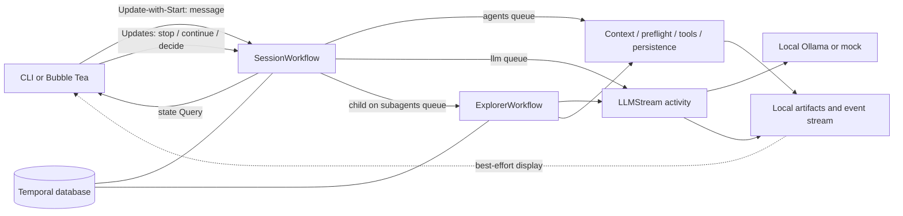
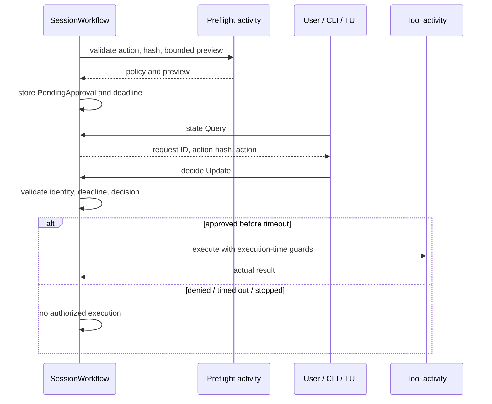

# Architecture

[Quickstart](../README.md) · [Operations](operations.md) · [Testing](testing.md)

## Durable control, activity-side I/O

- [Client](../internal/client/client.go): Update-with-Start returns a completed **enqueue receipt**, not a model response. Open sessions are reused; closed IDs are rejected. Queries and Updates omit the run ID so they follow Continue-As-New.
- [Session workflow](../internal/workflows/session.go): stays open and queryable after logical-run settlement. `idle` can describe either the last success or a last failure; inspect `LastRunFailure`, not status alone.
- [Worker](../internal/worker/worker.go): polls fixed queues `agents`, `llm`, `subagents`. The LLM worker permits one concurrent activity per worker. Multiple harness processes on the same server/namespace share queues, not private sessions; isolate experiments with a separate server.
- [Activities](../internal/activities) own filesystem, processes, model calls, and display emission. Workflow code uses deterministic Temporal primitives, not filesystem/network I/O or native goroutines.
- [Contracts](../internal/workflows/contracts.go) define the bounded state snapshot and activity inputs/results. Full transcript text is artifact-backed rather than copied wholesale into workflow history.

## The four patterns

### 1. Long-running activity

[Workflow loop](../internal/workflows/loop.go) calls [LLMStream](../internal/activities/model.go) on `llm`: 10-minute start-to-close, 30-minute schedule-to-close, 15-second heartbeat timeout, at most two attempts. [Independent heartbeats](../internal/activities/partial.go) continue even while the provider is silent; they carry token progress and a partial-artifact reference. Missing models and invalid requests are nonretryable. A failed attempt restarts the turn, not the provider's hidden partial state. A persisted completed response is reused on retry.

[RunCommand](../internal/activities/command.go) demonstrates a second heartbeating activity: streamed stdout/stderr, a bounded tail, silence/hang timeout, and process-group cancellation. Commands are unsafe and use **one attempt**, not the LLM retry policy.

### 2. Parallel execution

[Tool executor](../internal/workflows/toolexec.go) preflights and authorizes in model order before execution. All-parallel-safe batches use a workflow semaphore of four; any sequential/unknown tool makes the whole batch sequential. Results remain in model order, while display events can arrive in completion order. All futures are joined rather than failing fast. Initial git/tree/README/TODO context gathering also uses concurrent activities.

### 3. Child workflow

[ExplorerWorkflow and delegation](../internal/workflows/explorer.go) use deterministic `<session>/explore-N` child IDs, the `subagents` queue, a separate transcript, read-only tools, and bounded step/token budgets. The parent receives a bounded summary plus `SummaryRef`. Parent and child retain distinct workflow/run identities while writing into the parent's display stream. Cancellation joins child cleanup; parent-close policy requests child cancellation. The real explorer still calls the selected provider; it is not replaced by the parent's fixture action plan.

### 4. Approval as recorded control

[Approval workflow](../internal/workflows/approval.go) combines pure [tool policy](../internal/workflows/toolexec.go), activity-side validation/hash/preview, a durable pending request, a `decide` Update validator, and a workflow timer. Decisions bind the current request ID and canonical action hash; stale, mismatched, expired, or conflicting decisions are rejected. Denial needs a reason. [TUI](../internal/tui/modal.go) and [CLI](../cmd/harness/approval.go) re-query before submitting; notification/display failure is not an approval bypass. Timeout, denial, and Stop do not authorize execution.

## Inbox, stop, and rollover

[Inbox implementation](../internal/workflows/inbox.go):

- A maximum of 64 queued messages and 1 MiB of serialized inbox JSON; individual text is limited to 64 KiB. External callers cannot supply internal provenance fields.
- `followUp` waits for a new logical run. A `steer` can be consumed at a safe boundary in the current run; a late steer becomes next-run work. Submit receipts are `started`, `queued`, or `steered`.
- A FIFO window of 64 request receipts records payload digests. Same ID/same payload returns the receipt; changed payload is rejected within that window. This is **bounded idempotency**, not eternal exactly-once delivery.
- Stop cancels the current logical run, joins work, records failure, and pauses retained input; idle Stop is a no-op. Continue resumes unanswered context or retained FIFO work and rejects busy/nothing-to-answer cases. New genuine input also resumes retained work, oldest first.
- Continue-As-New is checked between runs, after 100 turns per execution by default or an SDK/server suggestion. It waits for Update handlers and excludes live children. Carry includes transcript reference, queued input, receipts, counters, failure/paused state, and verification provenance; it does not nest old carry objects.

## Post-write verification and guided demo

[afterRun](../internal/workflows/afterrun.go) runs before logical settlement, only after an otherwise successful run that wrote a file or inherited a pending verification obligation. It submits `go test ./...` through the **normal preflight and explicit approval gate**. The synthetic assistant intent and tool outcome are persisted together after joining execution.

- A confirmed zero exit, no execution/interruption error, and a log reference clear verification.
- A completed positive test exit may enqueue an internal fix follow-up: at most **two** per originating input. That follow-up retains its origin, consumed budget, and sticky verification obligation even if intervening genuine user work changes current state or Continue-As-New occurs.
- Verification remains required when a repair makes no further write. Continue does not replenish an exhausted origin budget. Genuine new user work starts a new origin; old queued repairs keep their own provenance.
- Denial, timeout, Stop, infrastructure failure, or unknown exit is not an automatic repair trigger. Failed model runs skip afterRun. Exhausted repair budget reports `restart_limit`; retained context remains available for explicit user action.
- [Joined-result persistence](../internal/workflows/persistence.go) exhausting retries fails the workflow closed rather than claiming settled success over an unresolved transcript.

[Scenario routing](../internal/workflows/loop.go) recognizes exact demo prompts (including `/demo`) for that run, not arbitrary mentions of “sample project.” [Forced demo plan](../internal/activities/demo_plan.go) runs **after a successful provider call**, replaces all parent provider-selected calls, and labels its commentary. It reads the fixture in parallel, delegates review, proposes an approved write, requests an approved test, and summarizes actual persisted results. It recognizes only the exact bundled broken/fixed fixture and a legacy fixed form; unrelated content is refused. It is an instructional script, not autonomous-tool-selection evidence. The scripted test and afterRun verification have distinct approvals.

## Truth and storage boundaries

- Authoritative control/completion: Temporal history and `state` Query, including bounded `Answer`, failure, inbox, and current approval. Final answers are capped at 8 KiB in workflow state.
- Authoritative conversation: activity-persisted transcript (bounded to 32 MiB) with stable entry identities and joined tool results. Artifacts must remain available at the stored paths.
- Observational only: JSONL events, streamed provider commentary, partial text, and command log bytes. A log is useful evidence, but a recovered tail alone cannot certify process completion or success. These artifacts do not replace Query or recorded tool results.
- [Event store](../internal/events/store.go) uses per-stream advisory locking/sequence allocation; [display emission](../internal/activities/basic.go) is best effort. Missing final events are not completion failures. Partial/log filesystem failures can still fail the owning activity: “display-only” does not mean every storage failure is ignored.
- [TUI reconciliation](../internal/tui/model.go) tails before querying, buffers, then applies only contiguous events newer than `LastSeq`; gaps, overflow, and truncation trigger re-query. Display is bounded and sanitized; the TUI does not load the full transcript artifact. See the [event protocol](events.md).

- [Committed replay coverage](../internal/workflows/replay_test.go) checks genuine mock-model histories for two Continue-As-New links, retained receipts/counters, completed explorer linkage with nil child Carry, three approvals, and successful scripted/afterRun command results. Replay uses original execution IDs and runs no activities. The four-event successor is only an open-history prefix; it proves no later execution. See [replay commands and limits](testing.md#recorded-replay-integrated18).
- Live mock and Gemma CLI demos passed the four patterns with the harness-enforced parent plan; the keyboard TUI smoke used mock. Neither establishes native model action selection. Reviewed/integrated hard-worker-loss evidence remains pending the orchestrator's final patch.

Durability depends on both Temporal's database and local artifacts, not replay alone. There is no multi-host shared-storage guarantee or compatibility promise for intermediate draft workflow histories. Fresh IDs are recommended after workflow code changes; captured replay fixtures only test current code against those particular histories.
