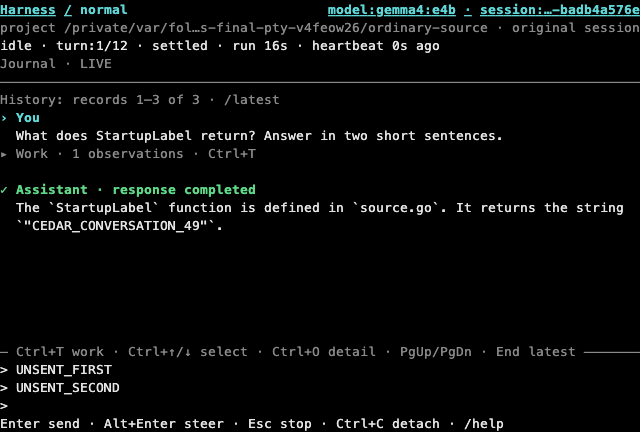
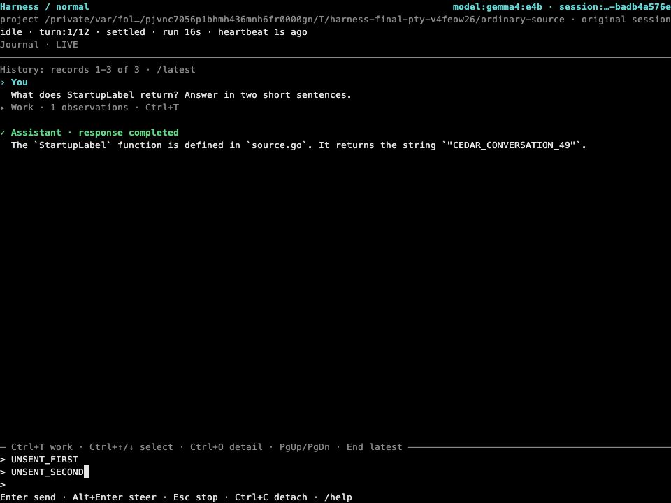
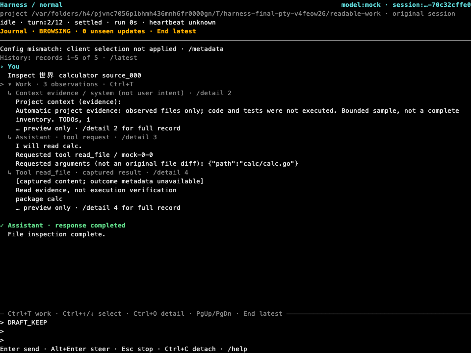
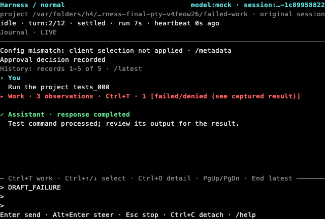

# Conversation-first terminal

This follow-up corrects the readability problems in draft22 rather than replacing the durable-session implementation.

## What is visible by default

- **Cyan `› You`** identifies the prompt. **Green `✓ Assistant · response completed`** identifies a completed response; long bodies stay neutral. The check means a response completed, **not that tests passed**.
- Blank space separates turns and responses. Prose wraps at word boundaries with a consistent inset; oversized tokens still hard-wrap. Raw detail/log views retain literal cell wrapping.
- **One collapsed Work block per loaded prompt** summarizes intermediate context, tool requests/results and child work. Validated failures remain red and visible; interrupted/unknown outcomes and approval headings use amber. Color is supplemented by labels/markers.
- **Ctrl+T** expands the selected work group, or the latest group visible in the viewport. Expanded receipts have short, indented previews; full bounded records remain available via Ctrl+O or `/detail N`. Full captured command logs remain available through Ctrl+L or `/log`.
- A live observation that cannot be reliably associated with a prompt stays in a separately labeled **unassociated** block. This is deliberately honest, not inferred from tool-call IDs or proximity to an old prompt. Partial pages similarly identify earlier/partial work.
- The header keeps the original project/model and distinguishing session suffix without consuming ten rows. Long paths retain their basename; `/metadata` exposes full bounded values.
- The separated multiline composer remains pinned. End resumes live following; scrolling/selection/expansion do not submit its draft. Approval still uses a dedicated view and refuses hidden decisions below 40×12.
- An unavailable history page has one concise notice; `/history-error` opens the bounded diagnostic without submitting a message. Cached conversation remains available.

## Build and open this branch

Switching branches does not replace an existing executable. From the repository checkout:

```sh
git switch stack/23-conversation-first
mise exec -- go build -p 1 -o bin/harness ./cmd/harness
mise exec -- ./bin/harness tui
```

Restart the TUI with the newly built binary. This does not require restarting Temporal or Ollama. Existing sessions retain their original configuration; use the existing `--session` flag to reconnect.

## Native terminal captures

These PNGs are **reference-profile rasterizations of actual PTY cells**, not HTML mockups or OS-terminal screenshots. Profile: 8×18 cells, Menlo/monospace, virtual-terminal default palette. Actual fonts/backgrounds depend on the user's terminal. Captures use disposable controlled projects; the ordinary response came from local `gemma4:e4b`, not a fabricated transcript.

### Ordinary conversation, 80×24



### Ordinary conversation, 120×40



### Expanded receipts



### A real failing command, still visible while work is collapsed



## Verification and limits

Actual PTY checks exercise complete conversation, expansion/recollapse, cyan/green headings, red failure, amber approval, tiny approval refusal, multiline drafts and 80/120-column resizing, a source-grounded real-model response, and actual `NO_COLOR` foreground suppression. A controlled Go test waits five seconds before failing so the observer can capture a genuinely loaded, working conversation—not an answered frame renamed as active. Only private test servers/workers/projects are used and cleaned.

History, expansion, previews, bodies and logs remain bounded. A preview is not the complete record; use detail/log controls for deeper inspection. Near the 512 KiB display ceiling, the same frozen window falls back to native cell wrapping rather than losing additional source or exceeding the bound; word-boundary wrapping and continuation gutters may disappear in that boundary case. Omission notices and selection use the same bounded projection. One-column Unicode reflow is finite, with source restored when the terminal is widened. Source evidence, assistant prose and lossy events cannot certify command success. No dependency, workflow, backend API or replay-fixture changes are needed for this presentation correction.

### Qualified source

Production source and all captures above are from `5edd4009888e58961f7917e5f8db1b9af696d1da` (2026-11-11). A fresh serialized gate passed build, vet, uncached full unit and race suites, `go mod tidy -diff`, formatting and diff checks. The TUI package completed in 15.427s normally and 212.658s under race, without raising the default timeout. Fresh PTYs passed all four cases described above; the owned server and worker both joined with exit 0 and cleanup reported no errors.

Independent fresh-context source reviews closed grouping, navigation, Unicode, budget/geometry and performance findings. Reviewers used the same configured OpenAI provider; this is not a cross-provider claim. Final visual evaluation inspected all 15 fresh native captures against the actual approved sketch: PASS, all four earlier priorities closed and no open priorities. This is visual evidence, not a substitute for the behavioral tests.

Earlier failed runs are not counted as passing evidence. One unchanged worker connection-close test timed out locally; five unchanged focused repeats and the final full normal/race gates passed, with no established cause or worker change. An earlier full race run exhausted its ten-minute package limit. Profiling identified repeated ASCII suffix scans in the new wrapping path; a narrowly scoped optimization retained existing assertions, fixtures and limits. The final run above is separate evidence, not a relabeling of either failure. Non-ASCII reflow retains its prior cost; no general linear-time Unicode or constant-memory claim is made.

See [terminal controls and limits](terminal-journal.md) and [draft-stack checks](pr-stack.csv).
